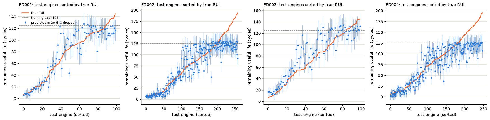

# NASA C-MAPSS: remaining useful life with a CNN–LSTM–Transformer

Predicts how many operating cycles a turbofan engine has left from its last 30 cycles of sensor readings, on NASA's
C-MAPSS run-to-failure simulations. One model per subset, a validation split by engine, a linear baseline, three
seeds, and every number below regenerated from saved run files.

This is a rebuild of a course project. The original notebook spliced different engines together, leaked its
validation split and reported a test score with no code behind it. [What the rebuild fixed](#what-the-rebuild-fixed)
lists each change; the original is kept in [legacy/](legacy/).

## Results

Test RMSE in cycles (lower is better), mean ± standard deviation over 3 seeds, on the last window of every official
test engine.

| Subset | Operating conditions | Fault modes | Test engines | Hybrid | Ridge baseline | Hybrid, capped truth | Ridge, capped truth |
|---|---|---|---|---|---|---|---|
| FD001 | 1 | 1 | 100 | 16.61 ± 1.00 | 16.52 ± 0.07 | 15.65 ± 1.09 | 15.16 ± 0.05 |
| FD002 | 6 | 1 | 259 | 25.80 ± 0.41 | 29.26 ± 0.20 | 15.03 ± 0.29 | 16.66 ± 0.09 |
| FD003 | 1 | 2 | 100 | 16.48 ± 1.92 | 18.53 ± 0.17 | 15.64 ± 2.21 | 16.94 ± 0.22 |
| FD004 | 6 | 2 | 248 | 27.17 ± 0.75 | 30.48 ± 0.08 | 16.49 ± 0.38 | 19.54 ± 0.03 |

"Capped truth" caps the official remaining life at 125 cycles, the cap the model is trained on, as many papers do.
The ridge baseline is a linear model on each window's per-feature mean, last value and slope, fitted on the same
engines. The full table, with validation scores, the PHM08 challenge score, both learning rates and training details,
is in [results/RESULTS.md](results/RESULTS.md).

What the numbers say:

- **The hybrid beats the linear baseline on FD002, FD003 and FD004.** The gap is largest on the two subsets that mix
  six operating conditions: against capped truth, 15.0 vs 16.7 cycles on FD002 and 16.5 vs 19.5 on FD004.
- **It does not beat it on FD001**, the simplest subset (one condition, one fault mode): 16.6 vs 16.5 cycles against
  the official truth, 15.7 vs 15.2 against capped truth.
- **Official-truth RMSE on FD002 and FD004 is 26–27 cycles because of the cap.** 57 and 67 of their test engines have
  more than 125 cycles left (up to 195), and a model trained on capped targets tops out near 125 (its highest
  prediction is 134): the flat ceiling in the figure. Those engines also account for most of the PHM08 score on these
  two subsets.
- **The uncertainty estimates are not calibrated.** Monte Carlo dropout ±2σ intervals contain the true value for
  46–80% of test engines, depending on subset and seed, not the ~95% a calibrated interval would. Read them as
  relative confidence, not as intervals.

No comparison with published results is claimed: papers differ in window length, cap, normalisation and which test
engines they score.



*Every official test engine, sorted by true remaining life. Seed 1 of the selected configuration; bars are ±2σ over
50 dropout passes.*

## What the rebuild fixed

| Original notebook | Now |
|---|---|
| Unit numbers restart in every subset, and FD002–FD004 were concatenated before grouping by unit, so 17,101 of 126,988 training windows (13.5%) spliced two engines together. | Engines are keyed by subset and unit, there is one model per subset, and a test checks that no window spans two engines. |
| The train/validation split was random over windows, so every validation window came from an engine also seen in training. | Validation holds out 20% of the training engines whole, and the scaler is fitted on the remaining engines only. |
| Targets were uncapped (up to 542 cycles), and sensors were scaled globally across six operating conditions. | Targets are capped at 125, and sensors are standardised within each operating condition. |
| Test engines shorter than the window were skipped (47 in FD002–FD004). | Every official test engine is scored; the 17 shorter than the window are padded with their first reading. |
| The cell behind the reported test MAE has no code. | Training writes one JSON per run, and `python -m cmapss.report` regenerates every table and the figure from those files. |

## Method

- **Inputs.** Windows of 30 consecutive cycles, stride 1. Sensors that are constant within every operating condition
  are dropped, and FD002 and FD004 add a one-hot of the operating condition (15, 23, 16 and 23 features).
- **Target.** Remaining life capped at 125 cycles (a piecewise-linear degradation target), scaled to [0, 1].
- **Model.** Two 1-D convolutions, a bidirectional LSTM, sinusoidal positional encoding, two Transformer encoder
  blocks, global average pooling and a dense head. Adam, MSE loss, early stopping on validation loss (patience 10),
  learning rate halved on plateau.
- **Learning rate.** Both 1e-3 and the original notebook's 1e-4 were run with three seeds. The rule, written into
  [cmapss/report.py](cmapss/report.py) before any 1e-4 run existed, picks per subset the rate with the lower mean
  validation RMSE. It picked 1e-3 on all four. On the test set, 1e-4 would have done slightly better on FD001, and on
  FD004 against official truth only; both are in the full results.
- **Test scoring.** The last 30-cycle window of each official test engine, against the official remaining life and
  its capped variant.
- **Uncertainty.** 50 forward passes with dropout left on.
- **Reproducibility.** Seeds are fixed and TensorFlow op determinism is on. Re-running all twelve 1e-3 runs reproduced
  every saved prediction exactly (same machine, CPU).

## Run it

Python 3.11. Download the C-MAPSS files (`train_FD00x.txt`, `test_FD00x.txt`, `RUL_FD00x.txt`) from the
[NASA Prognostics Center of Excellence data repository](https://www.nasa.gov/intelligent-systems-division/discovery-and-systems-health/pcoe/pcoe-data-set-repository/)
into `data/CMAPSSData/`, or point the `CMAPSS_DATA` environment variable at them.

```bash
python -m venv .venv
source .venv/bin/activate          # Windows: .venv\Scripts\activate
pip install -r requirements.txt

python -m cmapss.train --subset FD002 --seed 1     # one run: about 6–8 minutes on a laptop CPU
python -m cmapss.report                            # rebuild results/RESULTS.md and the figure
pytest -q
```

The full grid is 4 subsets × 3 seeds × 2 learning rates (`--learning-rate 1e-4` for the second), about three hours on
CPU.

```
cmapss/data.py      loading, engine keys, per-condition scaling, windows, engine split
cmapss/model.py     the CNN–LSTM–Transformer and MC-dropout prediction
cmapss/metrics.py   RMSE, MAE, PHM08 score, interval coverage
cmapss/train.py     one subset and seed -> results/runs/*.json
cmapss/report.py    results/runs -> results/RESULTS.md and the figure
tests/              data handling, metrics, model, learning-rate selection
legacy/             the original notebook and slides
```

## Limitations

- Predictions stay close to the 125-cycle cap, so engines with much longer remaining life are underestimated by
  construction of the target.
- The uncertainty intervals are too narrow (see above). Calibrating them on the validation engines, for example with
  conformal prediction, is the obvious next step and has not been done.
- Validation loss bottoms out early (best epoch 2–14 at the selected rate), and apart from the two learning rates
  there was no hyperparameter search.
- Three seeds per configuration. On FD003 the spread between seeds (±1.9 cycles) is comparable to the gap to the
  baseline.

## Data

A. Saxena, K. Goebel, D. Simon and N. Eklund, "Damage propagation modeling for aircraft engine run-to-failure
simulation," *International Conference on Prognostics and Health Management (PHM08)*, 2008. The data comes from the
NASA Prognostics Center of Excellence and is not redistributed here.
